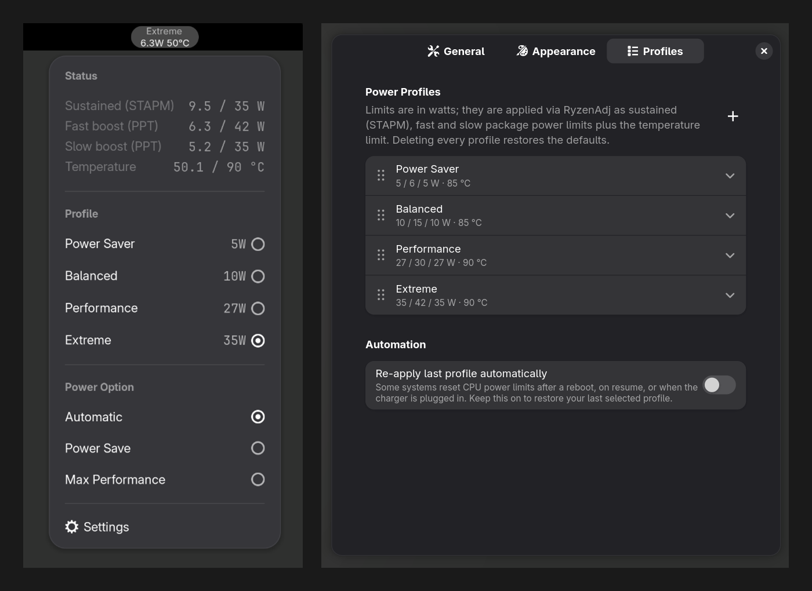

# RyzenAdj Switcher — GNOME Shell Extension

Monitor and control AMD Ryzen mobile CPU power limits from the GNOME top bar,
powered by [RyzenAdj](https://github.com/FlyGoat/RyzenAdj).



Supports GNOME Shell **46 – 50**.

## Requirements

- The `ryzenadj` binary (package `ryzenadj` on most distros).
- A loaded SMU access driver (`ryzen_smu`, or the stock `msr`/PCI access
  RyzenAdj supports on your platform).
- Permissions: see below.

## Installation

From source:

```sh
git clone https://github.com/cvcore/ryzenadj-switcher && cd ryzenadj-switcher
make install        # symlinks into ~/.local/share/gnome-shell/extensions
```

Then log out/in (Wayland) and enable it:

```sh
gnome-extensions enable ryzenadj-switcher@cvcore.github.io
```

## Permissions

`ryzenadj` needs root to talk to the SMU.
Since the extension polls readings every few seconds, a password prompt per
call is not workable. Instead it runs `sudo -n ryzenadj …` and relies on a
**one-time sudoers rule** that is deliberately minimal:

```
Defaults!<absolute path to ryzenadj> !log_allowed  # Optional: avoid cluttering the log
<your username> ALL=(root) NOPASSWD: <absolute path to ryzenadj>
```

Only your user, only this binary, nothing else. Open *Preferences → General →
Permissions*: it checks the rule and shows how to add it if missing.

### Optional: Quietening the sudo log

`sudo` logs every permitted command, and the extension reads power data every
few seconds — so the journal collects a few hundred
`COMMAND=…/ryzenadj --info` lines an hour, which buries your real sudo usage.
To silence just this one command, add a matching `Defaults` line above the
rule:

```
Defaults!/usr/bin/ryzenadj !log_allowed
<your username> ALL=(root) NOPASSWD: /usr/bin/ryzenadj
```

Use the same path in both lines. This only suppresses logging of *permitted*
runs of RyzenAdj — denials are still logged, and no other command is
affected.


## Development

```sh
make test      # unit tests (gjs or node) + schema compilation
make install   # symlink into the local extensions directory
make pack      # build the zip for extensions.gnome.org
```

Without `make`, the equivalent commands are:

```sh
glib-compile-schemas src/schemas
./tests/run.sh                 # honors $GJS, falls back to node
ln -sfn "$PWD/src" ~/.local/share/gnome-shell/extensions/
gnome-extensions pack --force --extra-source=indicator.js \
    --extra-source=ryzenadj.js --extra-source=lib src
```

**Fast iteration** — a running gnome-shell caches ES modules, so extension
code changes normally need a re-login. Instead, run a windowed dev shell that
loads the extension fresh each time:

```sh
make dev    # = dbus-run-session -- gnome-shell --devkit  (GNOME ≥ 49)
```
## Risks

This extension changes your CPU's power and temperature limits through
RyzenAdj. Applying aggressive settings can cause system instability, crashes,
unexpected shutdowns and data loss, may make your machine run hotter or
slower, and may void your hardware warranty. Whether a given limit is
sensible depends on your specific CPU, laptop and cooling — the values that
ship with this extension are conservative starting points, not
recommendations for your machine.

## License

GPL-2.0-or-later — see [LICENSE](LICENSE).

## Acknowledgements

This extension is an independent frontend for the
[RyzenAdj](https://github.com/FlyGoat/RyzenAdj) command-line tool
(LGPL-3.0). It bundles none of RyzenAdj's code — the tool is invoked as an
external program and must be installed separately.

"AMD" and "Ryzen" are trademarks of Advanced Micro Devices, Inc. This project
is not affiliated with or endorsed by AMD or the RyzenAdj project.
